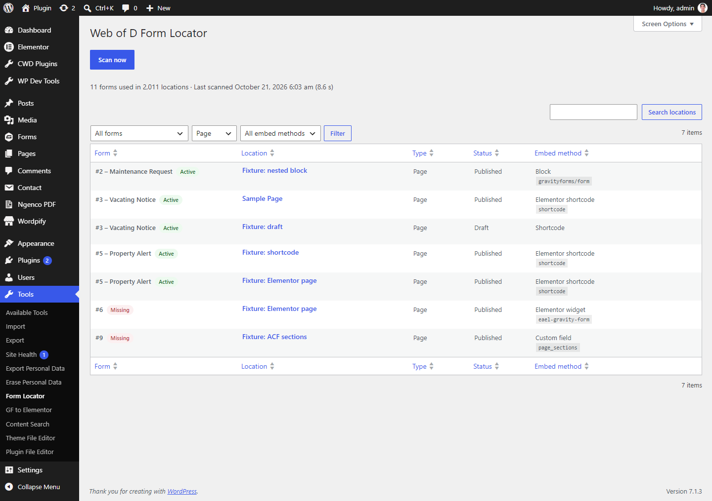
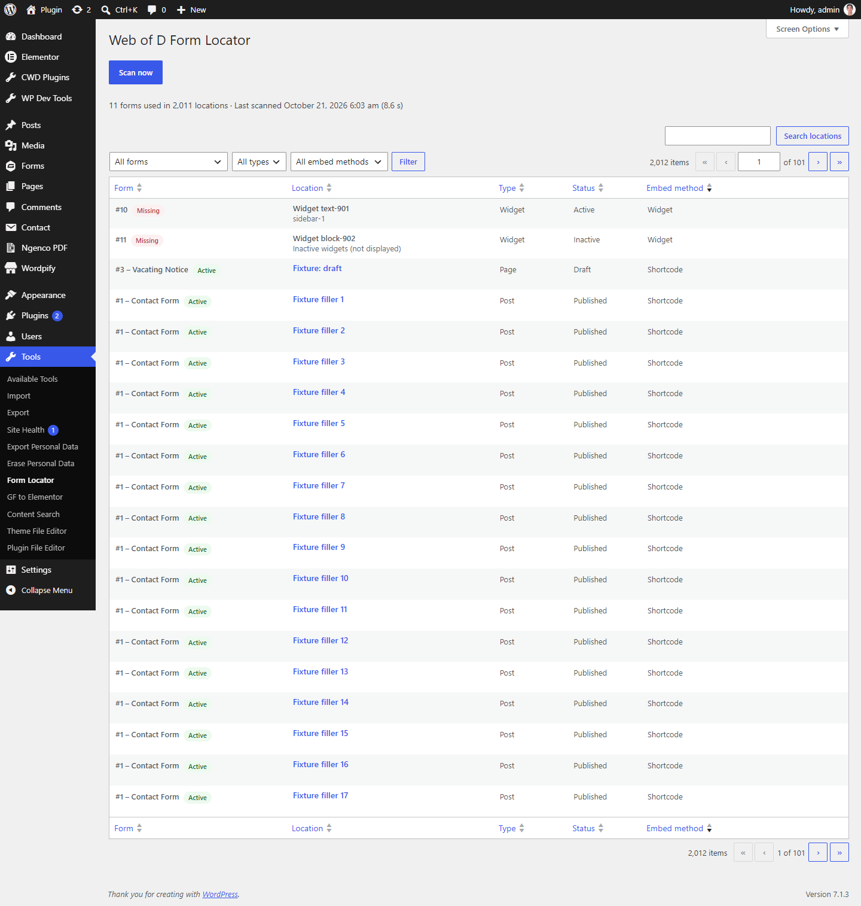

# Web of D Form Locator

Finds every page, template, widget and field where a Gravity Forms form is embedded, so you know exactly what breaks before you change or remove a form. **It works without Gravity Forms installed.**



## Features

- **Finds every embed method:**
  - `[gravityform]` shortcodes in post content
  - `gravityforms/form` blocks, including nested blocks and reusable blocks or patterns
  - Elementor shortcode widgets and third-party Gravity Forms widgets (for example `eael-gravity-form`)
  - shortcodes stored in post meta, including serialized and JSON values, which covers ACF fields and page builders
  - Text, Custom HTML and Block widgets, along with their sidebar and whether that sidebar is active
- **Shows form status.** Each form is labelled **Active**, **Inactive** or **Missing**, which means the form ID no longer exists. This makes broken embeds easy to spot.
- **Sortable, filterable report.** Filter by form, location type or embed method, search locations, and set rows per page under Screen Options.
- **Scans large sites safely.** The scan runs in batches over the REST API, keeps its progress between requests, and releases stuck locks. A 2,000-location site scans in a few seconds.
- **Covers every post status.** It includes published, draft, private and pending posts, so nothing is missed.
- **Multisite.** A network admin overview page is included, and uninstall cleans up every site.

## Screenshots

**All locations, sorted by embed method:** widgets, blocks and missing forms.



## Requirements

- WordPress 6.0+
- PHP 7.4+
- Gravity Forms is optional. Without it, the form names come straight from the database tables if those still exist.

## Installation

### From a release zip
Download the zip and upload it under **Plugins → Add New → Upload Plugin**, then activate it.

### From source
```bash
cd wp-content/plugins
git clone https://github.com/slightgrey/webofd-gform-locator.git webofd-form-locator
cd webofd-form-locator
composer install --no-dev
```
Then activate **Web of D Form Locator**. The plugin needs `vendor/autoload.php` (Composer's PSR-4 autoloader), so `composer install` must run before you activate it.

## Usage

1. Go to **Tools → Form Locator**.
2. Click **Scan now**. The results are saved, so you only need to rescan after content changes.
3. Filter, sort or search the report. Click a location to edit or view it.

## Permissions

By default the tool needs the `manage_options` capability. You can change this with a filter:

```php
add_filter( 'gffl_capability', fn() => 'edit_pages' );
```

## Development

```bash
composer install
composer test      # PHPUnit
composer lint      # PHPCS (WordPress Coding Standards + PHPCompatibility)
composer analyse   # PHPStan
php scripts/build-zip.php   # builds webofd-form-locator-v{VERSION}.zip
```

The build script installs production dependencies in a temporary staging copy, so your working `vendor/` is never touched.

## Uninstall

Deleting the plugin drops the `gffl_results` table and removes the `gffl_db_version`, `gffl_last_scan` and `gffl_scan_state` options on every site.

## License

GPL-2.0-or-later, as declared in the plugin header. The bundled [LICENSE](LICENSE) is the GPL-3.0 text, which the "or later" clause allows.
